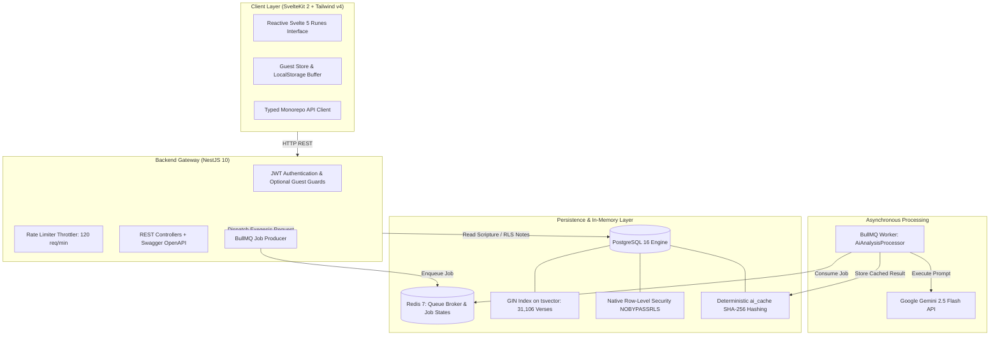

<div align="center">

# 📖 AI-Powered Exegesis & Theological Scripture Engine

**High-Performance Scripture Analysis Platform with Row-Level Security & Deterministic AI Queues**

[](https://www.typescriptlang.org/)
[](https://nestjs.com/)
[-FF3E00.svg?style=flat-square&logo=svelte&logoColor=white)](https://kit.svelte.dev/)
[](https://tailwindcss.com/)
[-336791.svg?style=flat-square&logo=postgresql&logoColor=white)](https://www.postgresql.org/)
[](https://bullmq.io/)
[](https://ai.google.dev/)
[](https://jestjs.io/)
[](https://turbo.build/)
[](LICENSE)

<p align="center">
  <b>Modern high-throughput scripture reading and theological exegesis platform engineered with PostgreSQL Row-Level Security (RLS) cryptographic isolation, sub-10ms GIN full-text search across 31,106 verses, asynchronous BullMQ workers, and SHA-256 cached Gemini AI analysis.</b>
</p>

[🇧🇷 Leia a Documentação em Português](README_PT.md) • [Architecture](#-architecture--system-design) • [Engineering Highlights](#-engineering-highlights) • [Monorepo Structure](#-monorepo-structure) • [Quickstart](#-getting-started)

</div>

---

## ⚡ Executive Summary

**AI-Powered Scripture & Exegesis Engine** is a full-stack, enterprise-grade research platform built to handle deep semantic textual study, synchronized user annotations, and on-demand theological exegesis without connection starvation or data leakage.

Architected as a TypeScript monorepo with **Turborepo**, it features a reactive **SvelteKit 2 (Svelte 5 Runes)** frontend and a modular **NestJS 10** backend gateway, delegating heavy LLM inferences to background **BullMQ workers** and user data isolation directly to the **PostgreSQL database kernel**.

---

## 🏛️ Architecture & System Design



---

## 🛡️ Engineering Highlights

### 1. Native PostgreSQL Row-Level Security (RLS)
Unlike typical applications relying on application-level filtering (`WHERE user_id = ...`) that risk catastrophic data leaks due to developer error, this platform delegates user data isolation directly to the **PostgreSQL database kernel**:
* Database connection role `biblia_app` is provisioned with strict `NOBYPASSRLS` privileges.
* Dynamic query execution executes within isolated transactions using `SET LOCAL app.current_user_id = '...'`.
* Native database policies enforce that a user's private annotations can never be read, modified, or joined by another tenant, even in the event of an application-layer bug.

### 2. High-Performance Inverted Full-Text Search
* Automatic `tsvector` generation using language stemming dictionaries (`config = 'portuguese'`).
* **Inverted GIN Index** spanning all **31,106 biblical verses**, delivering sub-10ms query execution times across full-corpus search queries.
* Algorithmic relevance scoring via `ts_rank_cd` with in-database contextual highlight generation via `ts_headline`.

### 3. Asynchronous Resilience via BullMQ & Redis
* AI theological exegesis requests run asynchronously through **BullMQ background workers**, keeping HTTP response loops responsive and preventing API gateway connection exhaustion.
* **Deterministic SHA-256 Result Caching:** AI prompts are hashed with SHA-256 and verified in PostgreSQL (`ai_cache`), returning instant responses for previously analyzed chapters and reducing LLM billing overhead.
* Real-time reactive polling lifecycle on the frontend (`queued` ➔ `active` ➔ `completed`).

### 4. Seamless Guest Mode & 1-Click Cloud Migration
* **Zero Barrier to Entry:** Unauthenticated visitors explore the entire scripture corpus, use full-text search, and author personal annotations stored locally in `localStorage`.
* **Atomic Cloud Migration:** The moment a guest registers or logs in, the client detects local annotations and triggers an atomic batch synchronization into PostgreSQL under their newly authenticated RLS tenant identity without data loss.

---

## 📁 Monorepo Structure

```text
bible-study-app/
├── packages/
│   ├── api/                     # Backend NestJS 10 Gateway
│   │   ├── src/database/        # Drizzle ORM schema, migrations, and seeds (31,106 verses)
│   │   ├── src/modules/
│   │   │   ├── auth/            # JWT, Refresh Tokens, Bcrypt, Guards
│   │   │   ├── bible/           # Book catalog, chapter pagination, and verse streaming
│   │   │   ├── search/          # GIN full-text search engine
│   │   │   ├── notes/           # Personal annotations secured with PostgreSQL RLS
│   │   │   ├── ai/              # Gemini AI integration, BullMQ worker, and SHA-256 cache
│   │   │   └── study-aids/      # Cross-references, key themes, and book summaries
│   │   └── test/                # Jest & Supertest integration test suites
│   │
│   └── frontend/                # SvelteKit 2 + Svelte 5 Runes SPA
│       └── src/
│           ├── lib/api/         # Strongly-typed HTTP API client with fault handling
│           ├── lib/components/  # High-performance reactive UI components
│           ├── lib/stores/      # Svelte stores (Auth, Session, Guest Buffer)
│           └── routes/          # SvelteKit routes (Reader, Search, Notes, Exegesis)
│
├── docker-compose.yml           # PostgreSQL 16 + Redis 7 local orchestration
├── turbo.json                   # Turborepo task pipeline configuration
└── pnpm-workspace.yaml          # Monorepo workspaces definition
```

---

## 💻 Getting Started

### Prerequisites
* **Node.js**: `>= 20.x`
* **pnpm**: `>= 9.x`
* **Docker & Docker Compose**

### 1. Install Dependencies
```bash
git clone https://github.com/neverleans/bible-study-app.git
cd bible-study-app
pnpm install
```

### 2. Start Docker Services
```bash
docker compose up -d
```
*Launches PostgreSQL 16 (:5434) and Redis 7 (:6381).*

### 3. Environment Configuration
```bash
cp packages/api/.env.example packages/api/.env
```
Configure `DATABASE_URL`, `REDIS_URL`, `JWT_SECRET`, and `GEMINI_API_KEY`.

### 4. Database Migrations & Seeds
```bash
pnpm db:push
pnpm db:seed
```

### 5. Launch Development Monorepo
```bash
pnpm dev
```
* **Frontend:** `http://localhost:5173`
* **API Gateway:** `http://localhost:3000`
* **Swagger OpenAPI Docs:** `http://localhost:3000/api/docs`

### 6. Run Test Suite
```bash
# Execute full test suite (62 tests)
pnpm test

# Run tests with coverage report
pnpm test:cov
```

---

## 📜 License

Distributed under the **MIT License**. See `LICENSE` for details.

---

<div align="center">
  <b>Engineered with precision by Lucas Ventavele Ribeiro</b><br>
  <a href="https://linkedin.com/in/lucas-ventavele-ribeiro">LinkedIn</a> • <a href="https://neverleans.github.io">Personal Portfolio</a> • <a href="https://github.com/neverleans">GitHub</a>
</div>
