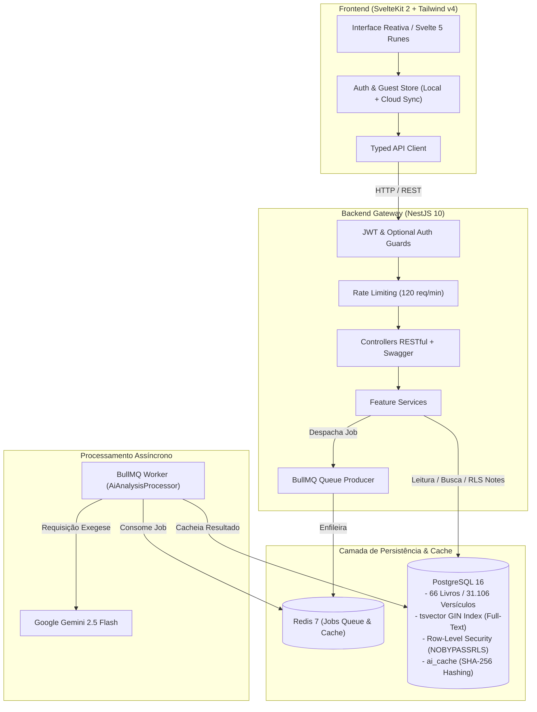

# 📖 Plataforma de Estudo Bíblico & Exegese com IA (Documentação em Português)

> Para a versão em inglês, veja [English README](README.md).

[](https://www.typescriptlang.org/)
[](https://nestjs.com/)
[](https://kit.svelte.dev/)
[](https://tailwindcss.com/)
[](https://www.postgresql.org/)
[](https://redis.io/)
[](https://bullmq.io/)
[](https://orm.drizzle.team/)
[](https://turbo.build/)
[](https://jestjs.io/)
[](LICENSE)

> Plataforma web moderna de alta performance para leitura bíblica, exegese teológica, pesquisa contextual e anotações pessoais, com isolamento criptográfico por **PostgreSQL Row-Level Security (RLS)**, filas distribuídas com **BullMQ + Redis**, busca full-text com dicionário em português e análises hermenêuticas via **Google Gemini**.

---

## 🏛️ Visão Geral da Arquitetura

O projeto foi concebido seguindo os mais rigorosos padrões de engenharia de software corporativa: monorepo com contratos fortemente tipados de ponta a ponta (100% TypeScript), separação clara de responsabilidades, arquitetura orientada a eventos e processamento assíncrono.



---

## 🚀 Diferenciais de Engenharia

### 1. PostgreSQL Row-Level Security (RLS) Nativo
Diferente de aplicações comuns que confiam apenas na cláusula `WHERE user_id = ...` na aplicação (vulnerável a vazamentos de dados por erro humano), este projeto delega o controle de acesso ao **núcleo do banco de dados**:
* Conexão da API configurada com a role `biblia_app` com privilégio estrito `NOBYPASSRLS`.
* Transações isoladas via `SET LOCAL app.current_user_id = '...'`.
* Políticas de segurança RLS aplicadas nativamente nas tabelas de anotações pessoais, impedindo qualquer vazamento entre usuários mesmo sob falha na camada de aplicação.

### 2. Busca Full-Text de Alta Performance (Português)
* Geração automática de coluna `tsvector` com o dicionário de stemming em língua portuguesa (`config = 'portuguese'`).
* **Índice GIN Invertido** cobrindo todos os **31.106 versículos bíblicos**, garantindo tempos de busca inferiores a 10ms.
* Algoritmo de relevância `ts_rank_cd` com destaques contextuais gerados em banco via `ts_headline`.

### 3. Fila Distribuída e Resiliência com BullMQ + Redis
* Chamadas para a API do Google Gemini são processadas de forma assíncrona por **Workers BullMQ**, prevenindo gargalos de conexão HTTP e timeouts.
* **Cache Determinístico** com hash SHA-256 dos prompts armazenado em PostgreSQL (`ai_cache`), economizando requisições e proporcionando respostas instantâneas para capítulos já analisados.
* Polling reativo no frontend com feedback de ciclo de vida (`queued` -> `active` -> `completed`).

### 4. Modo Visitante Inteligente (Guest Mode) & Sincronização em Nuvem
* **Acesso Livre:** Visitantes não logados navegam livremente pela Bíblia completa, utilizam a busca, visualizam recursos de estudo e podem criar anotações locais salvas no `localStorage`.
* **Migração Transparente em 1 Clique:** No momento em que o visitante cria uma conta ou faz login, o sistema detecta as anotações feitas no navegador e executa a sincronização em lote para o PostgreSQL sob a nova identidade RLS, sem perda de dados.

### 5. Blindagem de Segurança & Observabilidade
* Autenticação via **JWT (Access Token de 15m + Refresh Token rotativo de 7d)** com hash de senha `bcryptjs` (salt rounds: 10).
* Proteção contra ataques de negação de serviço e scraping com `@nestjs/throttler` (limite global de 120 req/min).
* Headers de segurança HTTP ativados via `helmet`.
* Documentação viva e interativa de todos os endpoints via **Swagger OpenAPI** em `/api/docs`.
* Endpoint de monitoramento de saúde `/health` utilizando `@nestjs/terminus`.

---

## 🛠️ Stack Tecnológica

| Camada | Tecnologia | Motivação & Benefício |
|---|---|---|
| **Monorepo** | Turborepo + pnpm | Pipeline de build ultrarrápida, cache de tarefas e workspaces organizados |
| **Backend** | NestJS 10 + Express | Arquitetura modular padrão corporativo com Injeção de Dependências |
| **Frontend** | SvelteKit 2 + Svelte 5 Runes | Reatividade nativa compilada de altíssima performance e sem overhead de Virtual DOM |
| **Estilização** | Tailwind CSS v4 | Estilização utilitária de última geração com suporte nativo a Dark Mode |
| **Banco de Dados** | PostgreSQL 16 | Suporte robusto a RLS, índices GIN e extensão full-text em português |
| **ORM** | Drizzle ORM | Type-safety absoluta sem overhead de runtime, com total controle sobre SQL |
| **Filas & Cache** | Redis 7 + BullMQ 5 | Fila distribuída de alta vazão para processamento de background jobs |
| **IA / LLM** | Google Gemini (`@google/genai`) | Análise teológica, exegese de capítulos e reflexões panorâmicas de livros |
| **Testes** | Jest + Supertest | Cobertura rigorosa com testes unitários e E2E em todos os módulos |

---

## 📊 Estrutura do Monorepo

```
projeto-estudo-biblia/
├── packages/
│   ├── api/                     # Backend NestJS
│   │   ├── src/
│   │   │   ├── database/        # Schema Drizzle, migrações e seeds (66 livros / 31.106 versículos)
│   │   │   ├── modules/
│   │   │   │   ├── auth/        # JWT, Refresh Tokens, Bcrypt, Guards
│   │   │   │   ├── bible/       # Catálogo de livros, capítulos e versículos
│   │   │   │   ├── search/      # Full-Text Search com tsvector e GIN
│   │   │   │   ├── notes/       # CRUD de notas isolado com PostgreSQL RLS
│   │   │   │   ├── ai/          # Gemini AI + BullMQ Worker + SHA-256 Cache
│   │   │   │   └── study-aids/  # Resumos, versículos-chave e referências cruzadas
│   │   │   ├── common/          # Decorators, interceptors, filtros e pipes globais
│   │   │   └── health/          # Verificação de integridade com @nestjs/terminus
│   │   └── test/                # Testes E2E (auth, bible, search, notes, ai, study-aids)
│   │
│   └── frontend/                # Frontend SvelteKit
│       └── src/
│           ├── lib/
│           │   ├── api/         # Cliente HTTP tipado com tratamento de erros
│           │   ├── components/  # Componentes reativos (Leitor, Notas, Busca, Modais de IA)
│           │   ├── stores/      # Stores Svelte (Auth, Sessão, Guest Notes)
│           │   └── types/       # Definições de tipos TypeScript compartilhadas
│           └── routes/          # Rotas SvelteKit (Home, Leitor, Busca, Notas)
│
├── docker-compose.yml           # PostgreSQL 16 (porta 5434) + Redis 7 (porta 6381)
├── turbo.json                   # Configuração de build e pipeline do Turborepo
└── pnpm-workspace.yaml          # Definição de pacotes do monorepo
```

---

## 🚦 Como Executar o Projeto Localmente

### Pré-requisitos
* **Node.js** >= 20.x
* **pnpm** >= 9.x
* **Docker & Docker Compose**

### Passo a Passo
```bash
# 1. Instalar dependências
pnpm install

# 2. Subir infraestrutura Docker (PostgreSQL 16 + Redis 7)
docker compose up -d

# 3. Configurar variáveis de ambiente
cp packages/api/.env.example packages/api/.env

# 4. Executar migrações do banco de dados e seeds
pnpm db:push
pnpm db:seed

# 5. Iniciar ambiente de desenvolvimento
pnpm dev
```

---

## 🧪 Suíte de Testes

```bash
# Executar todos os testes
pnpm test

# Executar testes com cobertura
pnpm test:cov
```

---

## 📜 Licença

Distribuído sob a licença **MIT**.
